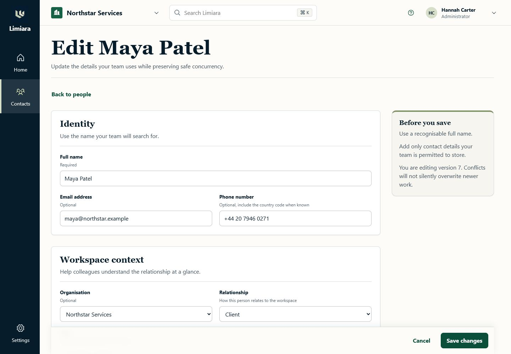
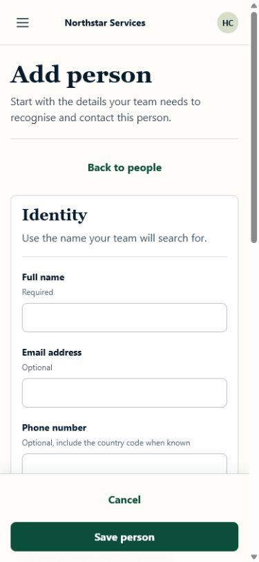

# Contacts UX benchmark and interaction brief

**Status:** Accepted direction for the first secure Contacts vertical slice

**Research date:** 2026-07-15

**Audience:** Product designers, frontend engineers, and implementation agents working on issues #96-#103

**Time horizon:** Gate 2, with patterns that can extend to later CRM and service-operations plugins

## Research question

How should Limiara help a small operational or CRM team move between a workspace, enabled modules, people, and organisations without inheriting the clutter, setup burden, or mobile compromises common in configurable CRMs?

The scan covers logged-in navigation, contact discovery, record creation and editing, record detail, responsive behaviour, permissions, empty/error states, and keyboard accessibility. It does not cover marketing sites, pipeline management, automation builders, reporting, or AI features.

## Executive read

The strongest products keep workspace context stable while the main panel changes, make global and local search easy to reach, and let a user understand a record before opening it. Attio demonstrates a clear sidebar/main-panel model and progressively discloses attributes, relationships, and activity on record pages. Twenty makes navigation, list views, and record layouts independently configurable, but that degree of flexibility is a later-stage capability rather than the right default for Limiara's first slice. folk is the clearest reference for fast contact discovery: people and companies are distinct, list rows contain identifying context, keyboard movement is deliberate, and the mobile profile becomes a focused single-column flow. Pipedrive validates the durable convention of separate people and organisation views, visible creation actions, and spreadsheet-like filtering for high-volume work.

Public discussion adds an important warning: clean configurable CRMs are praised, but flexibility becomes a burden when a team must design its own operating system before it can do daily work. Limiara should therefore ship an opinionated Contacts starting state, expose one obvious next action per screen, and let plugin contributions add capability without reorganising the user's mental model.

## Evidence and confidence

### Primary product evidence

| Product | Observed pattern | Implication for Limiara | Confidence |
| --- | --- | --- | --- |
| Attio | The workspace is split into a persistent sidebar and a main action panel. The sidebar groups workspace controls, quick access, product navigation, records, and lists. | Keep workspace and module context stable; reserve the content canvas for the current task. | High |
| Attio | All-record pages support views, filters, sorting, visible attributes, selection, and a top-right create action. Record pages combine details, relationships, and activity in progressively disclosed sections or tabs. | Make the People list the default working surface, then move to a deep-linkable record page with key fields and contribution slots. | High |
| Twenty | Navigation, record-list views, and record-page layouts are configurable independently. Table, kanban, and calendar views serve different jobs. | Keep plugin navigation, collection presentation, and record layout as separate contracts, but only ship the table/list representation needed for Contacts now. | High |
| folk | Global search separates People and Companies and shows identifying context such as company, job title, email, and group. The list supports keyboard navigation and selection. | Rows must answer “is this the right person?” without requiring a detail-page round trip. Search and row navigation are first-class interactions. | High |
| folk mobile | Mobile lands on People, offers People/Companies switching and search at the top, and uses a single scrollable record page with focused details, notes, and interactions. | Adapt rather than squeeze: mobile lists become compact rows and record details become one primary column with sticky or nearby actions. | High |
| Pipedrive | People and organisations have separate list/detail views. Creation is available from the relevant list and from related-record contexts. List views support filtering, sorting, and bulk work. | Use explicit nouns and contextual creation. Defer bulk actions, but do not block the layout from supporting them later. | High |

Primary sources:

- [Attio: Introduction to navigating Attio](https://attio.com/help/reference/attio-101/introduction-to-navigating-attio)
- [Attio: Create and view records](https://attio.com/help/reference/managing-your-data/records/create-and-view-records)
- [Attio: Attio on mobile](https://attio.com/help/reference/tools-and-extensions/attio-on-mobile)
- [Twenty: Layout overview](https://docs.twenty.com/user-guide/layout/overview)
- [Twenty: Record pages](https://docs.twenty.com/user-guide/layout/capabilities/record-pages)
- [folk: Search and organise contacts](https://help.folk.app/en/articles/6819356-search-organize-contacts)
- [folk: Contacts list and search on mobile](https://help.folk.app/en/articles/15178813-contacts-list-search-on-mobile)
- [folk: People and company profiles on mobile](https://help.folk.app/en/articles/15179426-people-company-profiles-on-mobile)
- [Pipedrive: Contacts — people and organisations](https://support.pipedrive.com/en/article/contacts-people-and-organizations)
- [Pipedrive: List view, filtering, and bulk editing](https://support.pipedrive.com/en/article/bulk-editing-and-filtering)

### Public user signal

The following is directional evidence, not representative user research:

- Recent CRM discussions repeatedly praise Attio and Twenty for clean interfaces and flexible data models, while also describing configuration and maintenance as work that can overwhelm smaller or less technical teams. See [this May 2026 Attio setup discussion](https://www.reddit.com/r/CRM/comments/1t5a20o/i_set_up_a_crm_on_attio_this_week_heres_what_i/) and [this June 2025 workflow discussion](https://www.reddit.com/r/CRM/comments/1leprv7/what_is_your_workflow/).
- Daily-work complaints focus less on visual polish than on the number of screens and clicks required to understand context or complete the next action. See [this March 2026 CRM workflow discussion](https://www.reddit.com/r/CRM/comments/1rpefpx/clunky_crm_experience_given_the_ai_advancement_is/) and [this June 2026 Attio activity-flow discussion](https://www.reddit.com/r/WhichCRM/comments/1ujgs2o/i_just_started_using_attio_and_i_dont_find_the/).
- These sources are anecdotal and include vendor-biased replies. They support a product risk—configuration without workflow guidance—but do not establish prevalence.

### Limiara baseline

The current React demonstration renders a single unstyled document with a workspace select, an `Enable Contacts` button, navigation links, and `Load`/`Create Ada` actions. It proves API wiring but provides no durable hierarchy, route model, responsive adaptation, loading affordance, or meaningful contact-management workflow. This is repository evidence, not a criticism of a shipped interface: the roadmap explicitly describes it as a demonstration shell.

## Ranked UX risks

| Rank | Risk | User goal that breaks | Severity | Frequency signal | Confidence | Recommended product move |
| --- | --- | --- | --- | --- | --- | --- |
| 1 | No stable information architecture | Know where they are, which workspace is active, and what they can do next | Critical | Every session | High | Ship an opinionated plugin-aware shell before feature screens. |
| 2 | Flexibility becomes a blank canvas | Start managing contacts without first designing a CRM | High | Common onboarding risk in public discussions | Medium | Provide a useful default People view and record layout; defer end-user layout builders. |
| 3 | Identity context is hidden in detail pages | Find the correct person or organisation quickly | High | Every search/list task | High | Put distinguishing fields in scannable rows and make search state durable. |
| 4 | Related context fragments across screens | Understand a person and their organisation without tab hunting | High | Repeated daily-work complaint | Medium | Keep key attributes and relationships together; reserve typed slots for future activity contributions. |
| 5 | Desktop density collapses on mobile | Search, create, and review a record away from a desktop | High | Every narrow-screen use | High | Design compact mobile representations and single-column record flows rather than shrinking tables. |
| 6 | Permission and plugin state appears as missing or broken UI | Understand why a module or action is unavailable | High | Every denied/disabled state | High | Explain disabled modules and denied actions without leaking protected data. |
| 7 | Loading and failure replace the user's context | Recover from slow, stale, or failed requests | Medium | Intermittent but unavoidable | High | Keep structure stable, preserve inputs, and provide local recovery actions. |

## Limiara interaction principles

1. **Keep context stable.** Workspace, enabled module, current route, and account/session controls remain in predictable positions while task content changes.
2. **Start with the user's object, not the platform.** Say People, Organisations, and Add person. Plugin architecture should enable the interface, not become interface copy.
3. **One screen, one obvious next action.** A list prioritises search and creation; a record prioritises understanding and editing; a form prioritises saving or safely leaving.
4. **Useful defaults before customisation.** Ship a curated People view, Organisation view, and record layout. Add saved/custom views only when a later roadmap item proves the need.
5. **Recognition before navigation.** List rows show enough identifying context to choose the correct record without opening several candidates.
6. **Progressively disclose complexity.** Lead with common fields and relationships; reveal custom fields, metadata, audit context, and future plugin contributions without turning every section into a card.
7. **Make state honest.** Loading, empty, filtered-empty, denied, disabled-plugin, stale, conflict, and failure states are distinct and give the next safe action.
8. **Adapt across widths.** Desktop uses density where it improves scanning. Mobile changes navigation, row composition, and action placement instead of compressing the desktop table.
9. **Keyboard is a primary input.** Logical tab order, visible focus, row movement, predictable Enter/Escape behaviour, and resilient focus restoration are part of the workflow.
10. **Contributions respect the host.** Plugins contribute routes, navigation, actions, and record context through typed slots; they do not introduce competing shells or arbitrary scripts.

## Adopt, adapt, avoid

| Pattern | Decision | Reason |
| --- | --- | --- |
| Persistent left navigation and main content panel | Adopt | Establishes location and leaves a stable place for plugin-contributed modules. |
| Search or quick access near the navigation root | Adopt | Reduces route hunting and scales as more plugins arrive. |
| People and Organisations as explicit, separate destinations | Adopt | Matches user language and prevents overloaded mixed lists. |
| Context-rich rows with avatar/initials, organisation, role, email, and optional label | Adopt | Improves recognition before navigation. |
| Deep-linkable record page with key details and related records | Adopt | Supports refresh/share/history and future contribution slots. |
| Single-column mobile record profile | Adopt | Fits the core lookup/edit task and avoids tab overload on narrow screens. |
| Unlimited user-configurable views and record layouts | Defer | Powerful but creates setup burden before the first slice has proven its defaults. |
| Command palette and extensive shortcut library | Adapt later | Preserve keyboard-friendly architecture now; add discovery and commands only when there are enough actions to justify them. |
| Spreadsheet-style inline editing everywhere | Avoid for Gate 2 | It complicates validation, permissions, optimistic concurrency, and mobile use. Use explicit edit flows first. |
| Dashboard cards for navigation or feature advertising | Avoid | Cards should represent independent objects or metrics, not replace hierarchy. |
| Separate plugin visual systems | Avoid | Contributions must inherit host tokens, components, focus behaviour, and state conventions. |
| Silent hiding for permission or lifecycle failures | Avoid | Users need an explanation and recovery path; hidden data must remain protected. |

## Desktop interaction brief

### Application shell

- Persistent navigation identifies the active workspace and enabled modules.
- The workspace switcher is compact but explicit; changing it clears stale record data before the new workspace is shown.
- Plugin contributions populate the module navigation. A disabled module is represented by a purposeful enablement/onboarding state, not a dead link.
- The main panel begins with a page title, short supporting context only when useful, and one primary action.
- Account/session and contextual help actions remain secondary.

### People list

- `People` is the heading; `Add person` is the primary action.
- Search is visible without opening a menu. Supported filter and sort state is reflected in the URL.
- Rows prioritise name, organisation, role/title, primary email or phone, and only the status/label fields required by the first slice.
- The entire name target opens the record; secondary row actions must not make the row itself ambiguous.
- Pagination keeps the user in context and distinguishes initial loading from fetching the next page.

### Person record

- The identity header combines name, organisation context, primary contact methods, archive state, and the primary Edit action.
- Key fields and custom fields are grouped by meaning with lightweight separators, not nested cards.
- Related organisation context is visible and navigable.
- A typed contribution region can later host activity/timeline content from CRM plugins; empty contributions do not create blank chrome.
- Archive is a clearly destructive secondary action with confirmation and focus restoration.

### Create and edit

- Use a dedicated route on narrow screens. On desktop, a drawer may be used only if it preserves deep-linking, browser history, focus management, and enough room for error messages; otherwise use a route.
- Common typed fields come first. Optional and custom fields are clearly identified without collapsing required context.
- Server validation is authoritative. Failed submission never clears entered values.
- Unsaved changes, permission denial, network failure, and version conflict have distinct recovery paths.

## Mobile interaction brief

- Use a compact top bar plus an accessible navigation drawer or bottom-level module switcher; do not render the full desktop sidebar.
- Land Contacts on the People list. Place People/Organisations switching and search near the top of the content.
- Render each record as a compact, comfortably tappable row with two or three lines of identifying context. Do not horizontally scroll the desktop column set.
- Keep `Add person` reachable without obscuring content or relying on an unlabelled floating icon.
- Use a single-column record flow: identity and quick contact actions, key details, organisation relationship, then lower-priority/custom fields and contributions.
- Forms keep the primary save action reachable above the virtual keyboard and never use side-by-side field layouts at narrow widths.
- Preserve route, search, form, and scroll context across orientation changes where the browser permits it.

## Screen and state inventory

| Surface | Core states required before completion |
| --- | --- |
| Application shell | loading contributions; active workspace; switching workspace; no enabled modules; Contacts disabled; contribution failure; unauthenticated; permission denied |
| People list | initial loading; populated; empty workspace; filtered no-results; fetching next page; pagination end; stale response discarded; recoverable error; denied |
| Person creation | pristine; partially complete; client feedback; server field errors; submitting; success; network failure; denied; unsaved-change confirmation |
| Person detail | loading; populated; not found; archived; stale/version changed; recoverable error; denied; workspace changed |
| Person editing | unchanged; dirty; validating; saving; success; server field errors; conflict; network failure; denied; unsaved-change confirmation |
| Organisations list | initial loading; populated; empty; filtered no-results; pagination; error; denied |
| Organisation detail | loading; populated; no related people; related people; not found; archived; conflict; error; denied |
| Plugin enablement | available to enable; enabling; enabled; enablement failure; not entitled; not permitted; dependency unavailable |

## Accessibility contract

- Use landmarks for application navigation, contextual navigation, main content, and complementary record context.
- Every route has one clear level-one heading and updates the document title.
- Focus moves to the new route heading after navigation, returns to the invoking control after modal/drawer closure, and moves to the first invalid field only after an attempted submit.
- Visible focus is never removed. Focus order follows the visual and task order.
- Table semantics are used only when data remains meaningfully tabular. Compact mobile rows use list/article semantics rather than a visually rearranged inaccessible table.
- Status, validation, loading completion, workspace changes, and destructive outcomes are announced without repeatedly interrupting typing.
- Colour is not the only signal for selection, status, errors, or permission state.
- Text and interactive states meet WCAG 2.2 AA contrast; controls meet target-size guidance; reduced-motion preferences are honoured.

## Handoff by backlog issue

| Issue | This brief supplies | Agent must decide or prove |
| --- | --- | --- |
| #96 | Semantic state list, hierarchy principles, contrast/focus requirements, and the no-card-clutter direction | Tokens, typography, maintained icon library, primitive APIs, and reviewable state showcase |
| #97 | Stable shell model, workspace/module hierarchy, lifecycle and permission states, responsive shell behaviour | Exact navigation implementation integrated with #33 and later #15-#17 |
| #98 | People list hierarchy, row content priority, URL state, loading/no-result distinctions, and mobile adaptation | API-state integration with #25/#27/#28 and measured row density |
| #99 | Form interaction contract, validation, unsaved work, conflict behaviour, and responsive constraints | Route versus drawer based on a working accessibility prototype |
| #100 | Record hierarchy, relationship context, archive behaviour, and typed contribution region | Concrete field groupings based on #24/#25 and contribution API with #33 |
| #101 | Separate organisation workflow and people relationship expectations | Organisation-specific layout and relationship mutation flow with #26 |
| #102 | Required viewports, adaptive rather than compressed layouts, and content-stress cases | Cross-screen responsive verification and fixes |
| #103 | Required state fixtures, accessibility behaviours, and desktop/mobile visual evidence | Deterministic Playwright implementation coordinated with #39 |

## Opportunity map

### Start now

- Use this brief to create three visual directions for the shell plus People list before #96 or #97 makes material styling choices.
- Build #96's tokens and primitives against the complete semantic state list, not only the current happy path.
- Keep #33's routing and contribution model independent from the visual shell so plugin state can be tested without rendering every feature.

### Deliver in Gate 2

- Implement #97-#101 in dependency order, using realistic fixtures while APIs stabilise.
- Treat #102 and #103 as exit work for every core state, not a final cosmetic pass.
- Validate the People list, person create/edit, and person detail journeys with representative users before declaring #34 complete.

### Needs deeper research

- Whether small operational teams prefer a desktop drawer or full-page route for rapid contact creation.
- Which three to five fields best distinguish contacts in Limiara's first target sectors.
- How often mobile users need editing versus fast lookup and contact actions.
- When saved views, bulk actions, command search, or inline editing create enough value to justify their complexity.

## Desktop distribution decision gate

A desktop version is worth evaluating, but it is not required for Gate 2 and
Electron should not be the default assumption. The web application must remain
the canonical product surface and API client so a desktop package does not fork
the interaction model or business logic.

### Recommended order

1. **Responsive web application first.** Complete the shell and core Contacts
   journeys so every distribution target shares one accessible, deep-linkable
   product experience.
2. **Installable PWA as the lowest-cost baseline.** A manifest provides an
   installed, standalone launch surface, while service workers can support
   carefully designed offline and background behaviour. Browser and operating
   system support varies, so capabilities require progressive enhancement and
   explicit fallbacks. See [MDN's installability guide](https://developer.mozilla.org/en-US/docs/Web/Progressive_web_apps/Guides/Making_PWAs_installable)
   and [offline/background guidance](https://developer.mozilla.org/en-US/docs/Web/Progressive_web_apps/Guides/Offline_and_background_operation).
3. **Tauri 2 as the preferred native-wrapper candidate.** Limiara already uses
   Vite/React and Rust. Tauri recommends Vite for SPA frontends, uses the system
   webview rather than bundling a browser engine, and exposes native functions
   through explicit capabilities and permissions. See [Tauri's frontend
   guidance](https://v2.tauri.app/start/frontend/), [architecture overview](https://v2.tauri.app/start/),
   and [capability model](https://v2.tauri.app/security/capabilities/).
4. **Electron only when its bundled Chromium/Node ecosystem solves a measured
   requirement.** It offers a mature, consistent browser runtime and desktop
   ecosystem, but every release also owns Chromium and Node patching plus a
   high-consequence IPC/native boundary. Electron's own guidance requires
   sandboxing, context isolation, restrictive navigation, current releases,
   and validation of every privileged IPC sender. See the [Electron security
   checklist](https://www.electronjs.org/docs/latest/tutorial/security).

### A wrapper is justified when

At least two important user journeys require capabilities that the supported
web/PWA surface cannot deliver reliably, such as:

- durable background synchronisation or queued offline work;
- operating-system notifications while the main window is closed;
- controlled local file, attachment, scanner, printer, or device access;
- global shortcuts, tray/menu-bar presence, protocol/file handlers, or deep OS
  integration;
- managed enterprise installation, signed updates, or a predictable embedded
  rendering engine.

### Required evaluation evidence

- A short user/job statement for every native capability; “feels like an app”
  is not sufficient.
- A PWA/Tauri/Electron comparison covering signing, distribution, auto-update,
  bundle and memory cost, offline/background limits, webview consistency,
  accessibility, security patch ownership, and cross-platform testing.
- A threat-model update. Bundled UI must be local, privileged commands must be
  allowlisted and scoped, and remote/plugin content must never inherit native
  authority.
- A disposable spike that packages the same web build and proves login,
  workspace switching, deep links, secure update verification, and one real
  native capability without adding desktop-only domain logic.
- An explicit stop decision if the PWA meets the validated jobs more cheaply.

Track this decision in #105. The packaging spike should begin only after the
application shell has a stable route and session model. Its conclusion should
inform, but not block, the later offline field PWA in #70-#71.

## Selected visual direction

The combined warm editorial People workspace direction is the accepted visual source for issues #96-#103. It combines the narrow ink module rail and forest active state with a stable workspace bar, a scan-friendly grouped People directory, and an adjacent record preview on wide screens. Its visual language is documented and implemented as reusable foundations in [UI foundations](./ui-foundations.md); the source image is preserved at [contacts-people-workspace-direction.png](./assets/contacts-people-workspace-direction.png).

The image is directional rather than a pixel specification for every later screen. Each implementation issue must preserve its hierarchy, palette, restrained surface treatment, and editorial/sans typography while proving the interaction and accessibility requirements in this brief.

## Metadata-driven person form evidence

Issue #118 applies the shared renderer to the Contacts plugin's person resource and page definitions. The same metadata drives create and edit routes, including permitted tenant `__c` fields, authoritative validation and failure handling, and optimistic-concurrency recovery.

The checked implementation has one `main` landmark and one H1 at desktop and mobile widths, introduces no horizontal overflow, focuses the first invalid field, retains values after a failed save, and preserves edits through an ETag conflict retry. These captures use synthetic fixture data and contain no customer information.

## Contacts metadata migration parity

The #119 delivery leaves React entrypoints responsible for URL, workspace, and
fixture action orchestration only. Contacts owns the page/resource definitions;
the host renderer contains no People, person, organisation, or Contacts branch.

| Journey and original slice | Metadata owner | Preserved behavior and state evidence |
| --- | --- | --- |
| People discovery (#98, #131) | `platform.contacts.people-directory` | Search, relationship filter, sort, opaque cursor, selection/preview, clear/reset, browser-history query state, loading, empty, no-results, denied, error, archived, stale selection, disabled plugin, wide rows, and compact cards. |
| Person create/edit (#99, #118) | `platform.contacts.person-form` | Create/edit modes, permitted standard and `__c` fields, validation, duplicate/network/denied failures, ETag conflict recovery, retained values, focus, and return routes. |
| Person detail (#100, #132) | `platform.contacts.person-detail` | Deep link, caller-safe contact/organisation/custom/version values, edit, archive/restore, missing/denied/error/archived/version-changed/workspace/plugin states, and empty or contributed card/action/related-list/timeline slots. |
| Organisation discovery (#101, #133) | `platform.contacts.organisation-directory` | URL-backed search/status/sort/cursor/selection, custom-field normalization, preview, create/edit targets, empty/no-results/denied/error/archived/stale cursor/stale selection/plugin states, wide rows, and compact cards. |
| Organisation detail and people (#101, #133) | `platform.contacts.organisation-detail` | Deep link, caller-safe organisation fields, declared people relationship, navigable people, link/unlink feedback, edit/archive/restore targets, empty relationship, missing/denied/error/archived/version/workspace/plugin states. |

The cross-page gate is `apps/web/src/contacts/ContactsMetadataParity.test.tsx`.
It proves route removal, caller-safe re-resolution after enablement, workspace and
permission changes, content-hash invalidation, stale-state behavior, and the
resource-neutral renderer boundary. `apps/web/src/plugin-ui/compose.test.ts`
proves deterministic contribution ordering plus plugin, host, permission,
missing-target, and duplicate-ID outcomes. The fixture plugin under
`fixtures/plugins/person-context` supplies all four stable contribution kinds.

`pnpm test:contacts-visual` runs Chromium at 1440 x 900, 834 x 1194, and
390 x 844 against repository baselines under `tests/contacts-metadata`. The gate checks all four
collection/detail views for horizontal overflow and H1/main landmarks, exercises
collection Arrow/Home/End focus behavior, and repeats representative content in
forced-colour and reduced-motion modes. Baselines contain synthetic fixture data.

The content-driven breakpoints, 834 x 1194 tablet state, 200%-zoom-equivalent
reflow, short-landscape form behaviour, and cross-viewport state invariants are
specified in [Responsive application behaviour](./responsive-behaviour.md).

Leaf implementation commits for the #119 close-out are:

- #130 — `cfc93dc` (`feat(metadata-ui): add collection and record primitives`)
- #131 — `ec0950e` (`feat(contacts): migrate people directory to metadata`)
- #132 — `6121959` (`feat(contacts): render person detail from metadata`)
- #133 — `1fab5a5` (`feat(contacts): render organisation views from metadata`)
- #134 — this parity, lifecycle, contribution, accessibility, and visual-gate change

## Research limitations and visual references

- The scan used public product documentation and public community discussions; no customer interviews, analytics, support tickets, or authenticated competitor accounts were available.
- Official help pages were visually inspected in the in-app browser on 2026-07-15. Those pages contain current product screenshots and GIFs, but third-party images are not copied into this repository because reuse rights are unclear. Source links above are the canonical visual references.
- Public discussion is biased toward users motivated to post and sometimes includes vendor promotion. It is used to identify risks and questions, not to estimate incidence.
- Limiara had no existing design system or styled production screen at research time. A concrete visual target has now been selected and preserved above; later implementation should evolve it through the shared tokens and primitives rather than inventing a competing direction.
